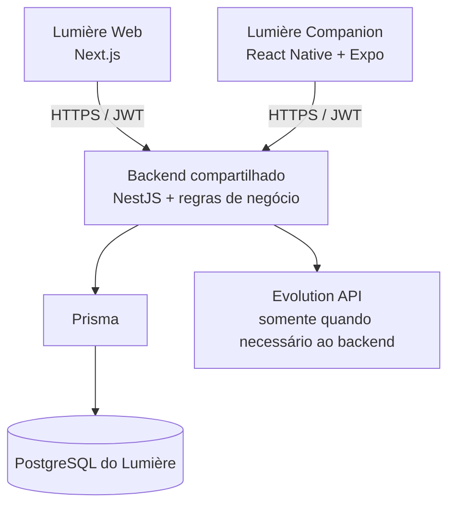
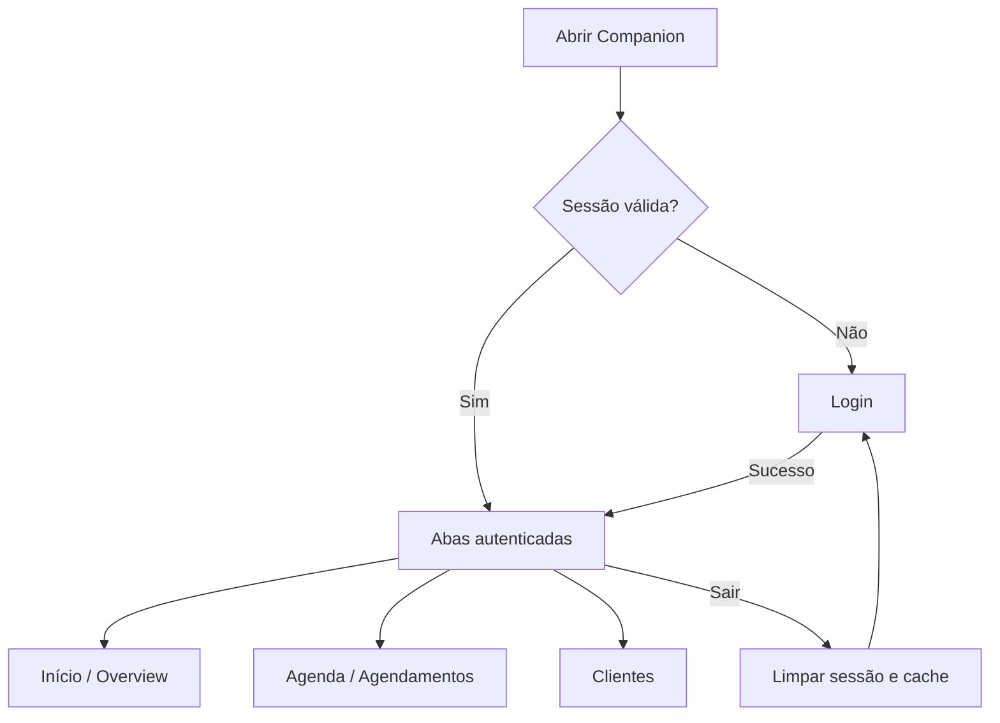

# LUMIÈRE COMPANION — PLANO TÉCNICO, ARQUITETURA E ESCOPO DE DESENVOLVIMENTO

> **Documento de referência para implementação incremental do aplicativo mobile Lumière Companion**  
> **Data da definição:** 12 de novembro de 2026  
> **Situação:** planejamento técnico — não representa funcionalidades implementadas  
> **Projeto relacionado:** Lumière (plataforma web e API NestJS)  
> **Público deste documento:** equipe de desenvolvimento, agent de programação e avaliadores do projeto mobile.

---

## 1. Objetivo deste documento

Este documento consolida as decisões, opções tecnológicas, arquitetura, limites, requisitos, orientações de interface, etapas de execução e critérios de verificação do **Lumière Companion**.

Ele serve como **referência de implementação** para um projeto novo, independente do repositório Lumière. Não é especificação de endpoints já auditados, nem relatório de funcionalidades concluídas. Sempre que um detalhe depender de consulta ao código ou ao servidor, ele estará identificado como **a verificar**.

### 1.1 Fontes de verdade e ordem de consulta

1. **Backend real do Lumière**: controladores, DTOs, guards, contratos HTTP, autenticação e permissões.
2. **Frontend atual do Lumière**: linguagem visual, nomenclaturas, fluxos e significado dos indicadores.
3. **Documentação técnica e roadmap do Lumière**: contexto, decisões e débitos conhecidos.
4. **Este plano**: escopo e arquitetura propostos para o Companion.
5. **Documentação oficial das bibliotecas**: compatibilidade e configuração das versões instaladas.

Em caso de divergência entre este plano e o código executável do Lumière, **registrar a divergência e atualizar o plano; não inventar contratos**.

---

## 2. Visão geral do produto

O **Lumière** é uma plataforma web de gestão para salões de beleza que centraliza informações de estabelecimentos, clientes, serviços, disponibilidade e agendamentos. Conta com frontend Next.js e backend NestJS, PostgreSQL/Prisma e integração WhatsApp por Evolution API.

O **Lumière Companion** será um **aplicativo React Native complementar**, dedicado a uma experiência administrativa mobile simplificada. Ele oferecerá acesso às mesmas contas e informações do Lumière, por meio da **API NestJS existente**.

O Companion **não será um segundo backend**, não controlará a Evolution API e não terá esquema Prisma próprio. A interface deverá ser reconstruída segundo padrões de uso em smartphones, em vez de copiar diretamente as páginas desktop.

### 2.1 Resultado esperado do MVP

Um usuário com conta válida no Lumière poderá:

- Entrar no aplicativo com as mesmas credenciais da plataforma web;
- Visualizar a **visão geral** do salão autorizado;
- Consultar e filtrar **agendamentos**;
- Consultar e buscar **clientes**;
- Alternar entre as três áreas administrativas usando **navegação inferior**;
- Encerrar a sessão com segurança.

**Importante:** o MVP prioriza **leitura/consulta de dados reais**. Edição, criação e exclusão de clientes ou agendamentos **não fazem parte da entrega inicial**, salvo mudança explícita de escopo e existência de API adequada.

### 2.2 Telas escolhidas

| Origem no Lumière Web | Destino no Companion | Posição | Finalidade |
|---|---|---|---|
| `/login` | `/login` | Fora das abas | Autenticação JWT |
| `/overview` | `/overview` | Aba **Início** | Visão geral do estabelecimento |
| `/agendamentos` | `/agendamentos` | Aba **Agenda** | Consulta de reservas |
| `/clientes` | `/clientes` | Aba **Clientes** | Consulta de clientes |

**Três abas, quatro telas de conteúdo.** Um arquivo de redirecionamento de entrada (`index.tsx`) e os layouts do Expo Router são infraestrutura de navegação, não páginas funcionais adicionais.

---

## 3. Delimitação e princípios obrigatórios

### 3.1 Dentro do escopo

- Novo aplicativo Android prioritário, com arquitetura compatível com iOS se as dependências permitirem;
- React Native/Expo + TypeScript;
- Navegação inferior e layouts apropriados a dispositivos móveis;
- Reaproveitamento da identidade visual do Lumière;
- Login real na API existente e sessão JWT própria do dispositivo;
- Busca de informações pelo NestJS, com cache de consultas controlado;
- Loading, estados vazios, erros, ausência de conexão e atualização por gesto;
- Isolamento por salão respeitando a autorização do servidor;
- Testes, documentação e build demonstrável.

### 3.2 Fora do escopo inicial

- Cadastro de conta e wizard de salão;
- Landing page;
- Administração da Evolution API, QR Code e chatbot;
- Configuração de Agenda ou horários de funcionamento;
- Alterações em `schema.prisma`, migrations ou novas tabelas;
- Acesso direto ao PostgreSQL pelo aplicativo;
- Novo backend, Firebase, banco local de negócio ou duplicação das regras de reserva;
- Google Calendar, notificações push, WebSocket e modo offline com escrita;
- Login social, NextAuth ou compartilhamento físico de tokens com o navegador;
- CRUD completo de clientes/agendamentos neste MVP.

### 3.3 Princípios arquiteturais

1. **Uma base operacional:** o PostgreSQL do Lumière permanece a fonte de verdade.
2. **Uma API de negócio:** todas as regras e permissões residem no NestJS original.
3. **Dois clientes independentes:** Next.js e React Native apresentam a mesma informação em interfaces diferentes.
4. **Mesmo usuário, sessões distintas:** não copiar cookies ou tokens do navegador.
5. **Regras de tenant no servidor:** a interface não substitui verificação de pertencimento ao salão.
6. **Desenvolvimento incremental e reversível:** terminar uma fase, testar, documentar, então avançar.
7. **Sem mocks na entrega funcional:** placeholders e fixtures podem existir em desenvolvimento de layout, mas devem ser removidos/substituídos ou identificados antes da validação final.

---

## 4. Arquitetura e separação de projetos

### 4.1 Visão conceitual



O mobile **não** acessa Prisma, Redis, Evolution API nem PostgreSQL diretamente.

### 4.2 Organização física dos diretórios

```text
Projetos/
├── lumiere/                       # Projeto web existente
│   ├── src/                       # Next.js
│   └── lumiere-backend/           # NestJS + Prisma
│
└── lumiere-companion/             # Projeto NOVO e independente
    ├── assets/
    ├── src/
    ├── app.json
    ├── package.json
    ├── tsconfig.json
    ├── .env.example
    └── README.md
```

O Companion deve ter seu próprio `package.json`, dependências, `.gitignore`, variáveis de ambiente, README e histórico Git. Não importar módulos executáveis do Next.js ou arquivos do backend por caminhos relativos externos ao projeto.

### 4.3 Regra sobre melhorias de backend

Caso a Fase 0 identifique endpoints ausentes:

- Registrar qual endpoint/DTO/guard faz falta, o formato mínimo esperado e o motivo;
- Abrir uma **tarefa separada para o repositório Lumière original**;
- Implementar a alteração **apenas no backend original**, após autorização;
- Exigir autenticação, autorização por salão, validação de entrada, testes e documentação;
- Só então consumir o endpoint no Companion.

A ausência de endpoint não autoriza criar um servidor paralelo ou consultar diretamente o banco pelo app.

---

## 5. Tech stack escolhida

| Responsabilidade | Escolha | Motivo |
|---|---|---|
| Framework mobile | **React Native + Expo** | Menos configuração nativa; builds e testes simplificados |
| SDK Expo | **SDK 58 como alvo inicial**, sujeito à checagem de compatibilidade no setup | Base recente, sem fixar dependências incompatíveis |
| Linguagem | **TypeScript** | Tipagem coerente com Lumière Web/Backend |
| Navegação | **Expo Router** | Rotas por arquivos e grupos `(auth)` / `(tabs)` |
| Abas inferiores | **Tabs de JavaScript do Expo Router** | Barra customizável, navegação simples e previsível |
| Requisições | **Axios** | Alinhado ao serviço HTTP do web; interceptors para autenticação |
| Dados assíncronos | **TanStack Query** | Cache, refetch, loading, invalidação e erros |
| Sessão / estado local | **React Context + hooks** | Baixa complexidade para autenticação e salão selecionado |
| Token sensível | **expo-secure-store** | Armazenamento protegido adequado a credenciais móveis |
| Formulários | **React Hook Form + Zod** | Validação e mensagens consistentes no Login |
| Layout/estilo | **StyleSheet + design tokens próprios** | Adaptação fiel sem depender de Tailwind |
| Ícones | **lucide-react-native + react-native-svg** | Consistência visual e boa integração com RN |
| Safe areas | **react-native-safe-area-context** | Ajuste a recortes, status bar e navegação do sistema |
| Rede | **@react-native-community/netinfo** | Experiência em conectividade ausente/instável |
| Testes | **Jest + jest-expo + React Native Testing Library** | Componentes, rotas e comportamento funcional |
| Lint/qualidade | **ESLint + TypeScript** | Consistência e verificações estáticas |

### 5.1 Decisões de compatibilidade

- O SDK deve ser confirmado durante a instalação conforme a documentação oficial e o aparelho/emulador disponível;
- Executar `npx expo install --check` e preferir `npx expo install` para pacotes nativos;
- Não fixar separadamente versões de React, React Native e módulos nativos sem verificar a matriz de compatibilidade do SDK;
- Expo Go e **development build** não são equivalentes: optar por development build se alguma dependência ou comportamento exigir;
- Android é a plataforma prioritária de demonstração; iOS é uma possibilidade, não um compromisso de entrega sem ambiente de teste.

### 5.2 Ferramentas deliberadamente não incluídas

**Redux, Zustand, Firebase, SQLite, Prisma no mobile, WebSocket, bibliotecas completas de UI, NativeWind e novos servidores** não são necessários inicialmente. Reavaliar somente diante de requisito concreto.

### 5.3 Setup inicial proposto

```bash
cd ~/Documents/Projetos
npx create-expo-app@latest lumiere-companion --template default@sdk-58
cd lumiere-companion

npx expo install expo-secure-store react-native-safe-area-context \
  react-native-svg @react-native-community/netinfo

npm install axios @tanstack/react-query react-hook-form zod \
  @hookform/resolvers lucide-react-native

npx expo install --check
npx expo start
```

**Atenção:** são comandos de referência de planejamento. O agent deve verificar nome do template e versões vigentes antes de executá-los. Não reinstalar pacotes já incluídos no template padrão.

---

## 6. Estrutura interna proposta

```text
lumiere-companion/
├── assets/
│   ├── fonts/
│   ├── icons/
│   └── images/
├── src/
│   ├── app/
│   │   ├── _layout.tsx
│   │   ├── index.tsx                 # Redirecionamento inicial
│   │   ├── (auth)/
│   │   │   ├── _layout.tsx
│   │   │   └── login.tsx
│   │   └── (tabs)/
│   │       ├── _layout.tsx
│   │       ├── overview.tsx
│   │       ├── agendamentos.tsx
│   │       └── clientes.tsx
│   ├── components/
│   │   ├── ui/
│   │   │   ├── Button.tsx
│   │   │   ├── Input.tsx
│   │   │   ├── Loading.tsx
│   │   │   ├── EmptyState.tsx
│   │   │   └── ErrorState.tsx
│   │   ├── dashboard/StatCard.tsx
│   │   ├── agendamentos/
│   │   │   ├── AppointmentCard.tsx
│   │   │   └── DateSelector.tsx
│   │   └── clientes/ClientCard.tsx
│   ├── contexts/AuthContext.tsx
│   ├── hooks/
│   │   ├── useAuth.ts
│   │   ├── useOverview.ts
│   │   ├── useAgendamentos.ts
│   │   └── useClientes.ts
│   ├── services/
│   │   ├── api.ts
│   │   ├── auth.service.ts
│   │   ├── overview.service.ts
│   │   ├── agendamentos.service.ts
│   │   └── clientes.service.ts
│   ├── storage/session.storage.ts
│   ├── theme/
│   │   ├── colors.ts
│   │   ├── typography.ts
│   │   ├── spacing.ts
│   │   └── index.ts
│   ├── types/
│   │   ├── auth.ts
│   │   ├── agendamento.ts
│   │   ├── cliente.ts
│   │   └── dashboard.ts
│   └── utils/
│       ├── dates.ts
│       └── errors.ts
├── __tests__/
├── .env.example
├── .gitignore
├── app.json
├── package.json
├── tsconfig.json
└── README.md
```

**Nomes de pastas são uma proposta;** o agent pode fazer ajustes pequenos por convenções do Expo Router, desde que preserve responsabilidades e documente a escolha. Arquivos de `types` são **DTOs/contratos de API**, não duplicação do schema Prisma.

---

## 7. Metodologia de construção do produto

Adotar **desenvolvimento incremental orientado por contratos e componentes**, com entregas pequenas, verificáveis e reversíveis.

### 7.1 Ciclo de cada fase

1. **Auditar:** verificar fatos do código, API ou identidade visual existentes.
2. **Delimitar:** escolher apenas os requisitos da fase.
3. **Projetar:** descrever fluxo, componentes e estados.
4. **Implementar:** alterar somente o projeto/área autorizada.
5. **Testar:** executar verificações adequadas e registrar saídas reais.
6. **Revisar:** comparar com critérios de aceite e corrigir regressões.
7. **Documentar e parar:** reportar arquivos alterados, decisões, pendências e próximo passo.

**Não presumir uso formal de Scrum.** O método escolhido para este projeto é um fluxo incremental próprio, com pontos de aprovação entre as fases.

### 7.2 Estratégia vertical

Construir uma funcionalidade completa por vez, em vez de desenvolver todas as telas estáticas e integrar tudo somente no final. Sequência sugerida: navegação → login → Overview → Agendamentos → Clientes → testes finais.

### 7.3 Estratégia de estados de interface

Cada consulta de dados deve contemplar no mínimo:

- **Loading:** carregamento inicial;
- **Success:** dados reais exibidos;
- **Empty:** consulta válida sem registros;
- **Error:** falha de API, autorização ou rede;
- **Refreshing:** atualização por gesto sem bloquear toda a interface;
- **Unauthorized:** sessão inválida/expirada;
- **Stale/offline:** exibição de cache, se permitido e claramente sinalizado.

O aplicativo não deve mostrar dados demonstrativos como se fossem retornos reais.

---

## 8. Método de adaptação da identidade visual

### 8.1 Regra fundamental

**Preservar a identidade; redesenhar a composição.** A versão mobile não é uma conversão CSS → React Native nem uma réplica exata dos breakpoints desktop.

### 8.2 Levantamento obrigatório antes das telas

O agent deve inspecionar no projeto web:

- Logo e variantes disponíveis;
- Cores primárias, secundárias, superfícies, bordas e estados;
- Tipografias e licenças/formatos dos arquivos locais já autorizados para uso no projeto;
- Componentes de formulário e botões;
- Espaçamentos, raios, sombras, bordas;
- Estilo de cartões e indicadores do dashboard;
- Ícones e microtextos;
- Estados reais de cada tela, usando screenshots do Lumière como referências, não como código.

Registrar os valores **extraídos do código atual** em `src/theme/`. **Não inventar uma paleta oficial** a partir de imagens nem assumir que propriedades CSS terão equivalência 1:1 no React Native.

### 8.3 Design tokens

Criar tokens semânticos, por exemplo:

```ts
// Modelo de organização, não valores finais da marca:
export const colors = {
  background: 'VALOR_A_EXTRAIR',
  surface: 'VALOR_A_EXTRAIR',
  text: 'VALOR_A_EXTRAIR',
  textMuted: 'VALOR_A_EXTRAIR',
  primary: 'VALOR_A_EXTRAIR',
  border: 'VALOR_A_EXTRAIR',
  success: 'VALOR_A_EXTRAIR',
  warning: 'VALOR_A_EXTRAIR',
  danger: 'VALOR_A_EXTRAIR',
};
```

Tokens de espaçamento e tipografia devem seguir escala consistente; não precisam copiar todos os números de CSS. Substituir placeholders por valores reais na implementação.

### 8.4 Transformações desktop → smartphone

| Padrão web | Adaptação mobile recomendada |
|---|---|
| Sidebar lateral | **Barra inferior com três abas** |
| Cards horizontais extensos | Grade de 2 colunas ou pilha vertical |
| Tabelas densas | `FlatList` com cartões e detalhes progressivos |
| Filtros em linha | Seletor de data + filtros compactos/bottom sheet |
| Cabeçalho desktop | Cabeçalho enxuto com salão e ação de conta |
| Campos estreitos | Inputs de largura disponível, teclado apropriado |
| Modais desktop grandes | Modal nativo ou painel inferior confortável |
| Hover | Feedback de toque, foco e estados pressionados |

### 8.5 Convenções mobile

- Respeitar **safe areas**, teclado, barra de gestos e status bar;
- Usar `ScrollView` em formulários curtos e `FlatList` em listas de dados;
- Utilizar alvos de toque confortáveis (referência inicial de 44–48 dp quando possível);
- Tratar acessibilidade: rótulos, tamanho de fonte, contraste, leitor de tela e estados não diferenciados só por cor;
- Manter componentes reutilizáveis com variantes semânticas;
- Testar tamanhos de tela distintos e modo retrato inicialmente;
- Evitar animações pesadas, carrosséis decorativos e elementos sem utilidade operacional;
- Usar datas no formato local do salão e preservar os timestamps corretos retornados pela API.

### 8.6 Critérios de aprovação visual

Uma tela só deve ser aprovada quando:

- Reconhecível como parte do universo visual do Lumière;
- Sem overflow horizontal, textos cortados ou controles encobertos;
- Navegação e ações acessíveis com uma mão de maneira razoável;
- Estados loading/empty/error implementados;
- Dados provenientes de API ou claramente marcados como fixture de desenvolvimento;
- Navegável com teclado e acessível em pelo menos dois tamanhos de viewport.

---

## 9. Navegação e organização das telas

### 9.1 Fluxo geral



### 9.2 Barra inferior

Três itens fixos:

1. **Início** — ícone `house` — rota `overview`;
2. **Agenda** — ícone `calendar-days` — rota `agendamentos`;
3. **Clientes** — ícone `users` — rota `clientes`.

O Login fica fora da navegação inferior. Logout e informação da conta podem ficar em um menu no cabeçalho do Overview. Se for necessário escolher entre dois salões autorizados, usar um seletor discreto no cabeçalho ou modal, não criar nova tela principal nesta fase.

### 9.3 Rotas protegidas

- Ao abrir o aplicativo, restaurar o token sem exibir indevidamente uma aba antes da checagem;
- Sem sessão, encaminhar ao Login;
- Com sessão válida, permitir acesso ao grupo `(tabs)`;
- `401` deve desencadear fluxo controlado de sessão inválida;
- A proteção no cliente é apenas experiência de navegação: **o NestJS deve validar todas as chamadas**.

---

## 10. Especificação das quatro telas

### 10.1 Tela A — Login (`/login`)

**Objetivo:** autenticar usuários com credenciais já existentes no Lumière.

**Composição:** marca/logotipo, título curto, e-mail, senha com opção mostrar/ocultar, botão Entrar, feedback de erro e estado de carregamento.

**Comportamento:**

- Validar campos localmente com React Hook Form + Zod;
- Enviar credenciais ao contrato real de login do NestJS;
- Tratar erro de rede, credenciais inválidas e respostas inesperadas;
- Persistir token usando `expo-secure-store` somente após autenticação bem-sucedida;
- Atualizar AuthContext e redirecionar ao Overview;
- Não criar usuários nem compartilhar cookies do web.

**Critérios de aceite:** login válido abre o Overview, login inválido não salva sessão, reinicialização restaura sessão ainda válida, logout limpa credenciais locais.

### 10.2 Tela B — Overview (`/overview`)

**Objetivo:** oferecer panorama administrativo resumido do salão autenticado.

**Composição:** nome do salão, saudação discreta, cartões de métricas disponibilizadas pelo backend, informações resumidas e acesso rápido às áreas relevantes.

**Comportamento:**

- Consumir o endpoint **real** do dashboard após auditoria;
- Não inventar novas métricas nem calcular indicadores a partir de amostras incompletas;
- Usar TanStack Query com chave ligada ao salão autorizado;
- Permitir pull-to-refresh e mostrar estados de carregamento/erro/vazio;
- Adaptar cards do web para duas colunas ou fluxo vertical.

**Critérios de aceite:** mesmos significados dos indicadores web, números reais da API, sem perda de legibilidade em telas menores.

### 10.3 Tela C — Agendamentos (`/agendamentos`)

**Objetivo:** permitir a consulta das reservas existentes no salão.

**Composição:** seletor horizontal de datas, filtros básicos conforme contrato, lista de cartões exibindo horário, cliente, serviço e status, estados vazio/erro/carregamento.

**Comportamento:**

- Priorizar `FlatList` e paginação se disponível;
- Usar filtros por data/status **apenas se suportados pela API**, caso contrário documentar limitação;
- Mostrar timestamp no timezone definido para o salão, evitando deslocar datas por interpretação incorreta de UTC;
- Exibir estados `PENDENTE`, `CONFIRMADO`, `CANCELADO`, `CONCLUIDO` e `FALTOU` conforme dados fornecidos;
- Exibir detalhes em modal, se necessários, sem ações de alteração no MVP;
- Não simular criação de reservas nem acessar diretamente `AgendaService` do backend por importação.

**Critérios de aceite:** lista somente reservas do salão autorizado, filtros coerentes, tratamento do dia sem reservas e horários sem mudança indevida de fuso.

### 10.4 Tela D — Clientes (`/clientes`)

**Objetivo:** permitir consulta rápida aos clientes do estabelecimento.

**Composição:** campo de busca, lista de clientes, cartão com nome e campos autorizados pela API; detalhe básico em modal opcional.

**Comportamento:**

- Buscar em API tenant-scoped, com paginação ou pesquisa no servidor quando disponível;
- Debounce de busca, se necessário;
- Usar `FlatList` para listas extensas;
- Não expor dados sensíveis desnecessários nem usar registros reais em screenshots públicas;
- Não oferecer edição/cadastro sem endpoint seguro e escopo aprovado.

**Critérios de aceite:** mostrar somente clientes acessíveis ao usuário/salão, buscar corretamente, tratar lista vazia e não reter dados de outra conta após logout.

---

## 11. Autenticação e ciclo de vida de JWT

### 11.1 Mesmo cadastro, login independente

```text
Usuário cadastrado no Lumière Web
               │
               ▼
           PostgreSQL
               ▲
               │
      NestJS (login / JWT)
          ▲           ▲
          │           │
       Next.js     Companion
       sessão web  sessão mobile
```

**Sincronizar identidade** significa usar a mesma base de usuários e os mesmos controles de autorização. **Não significa** reutilizar literalmente o JWT armazenado pelo navegador.

### 11.2 Fluxo de login

1. Enviar credenciais ao backend usando HTTPS em ambientes não locais;
2. Validar resposta no formato real retornado pela API;
3. Armazenar token somente em SecureStore;
4. Colocar usuário e salão autorizado no contexto da aplicação;
5. Adicionar `Authorization: Bearer <token>` às requisições autenticadas;
6. Tratar expiração e erro 401;
7. Ao sair, apagar token, estado da sessão e caches sensíveis.

### 11.3 Token expirado e renovação

- **Não inventar refresh token** caso o NestJS não ofereça esse mecanismo;
- Caso não exista renovação, voltar ao Login quando o JWT expirar;
- Evitar loops de redirecionamento e múltiplos logouts simultâneos;
- Não registrar JWT completo, senha, telefone pessoal ou payload sensível em logs;
- Não colocar token no `AsyncStorage` como escolha padrão quando SecureStore estiver disponível.

### 11.4 Multi-tenant

A associação de usuários aos salões é uma regra do servidor. Se a conta possuir mais de um salão, escolher somente entre opções retornadas/autorizadas pelo backend. Toda query deve considerar o contexto do salão e limpar/invalidate cache ao trocá-lo.

Nunca tratar um `salaoId` digitado ou alterado no cliente como autorização suficiente. O backend deve validar pertencimento a cada requisição.

---

## 12. API e contratos de dados

### 12.1 Regra de auditoria

O último estado documentado do Lumière indicava:

| Área | Estado histórico | Ação antes da implementação mobile |
|---|---|---|
| Auth | Integrada ao NestJS | Verificar rota, DTO, formato do token e perfil |
| Overview | Integrado ao backend | Confirmar endpoint e métricas |
| Clientes | Frontend web ainda com mocks | Verificar se já existe API real de leitura |
| Agendamentos | Frontend web ainda com mocks | Verificar se já existe API real de leitura |
| Agenda | Serviços internos existentes | Não presumir existência de controlador HTTP |

**Esse quadro é histórico e deve ser revalidado na Fase 0; não é afirmação sobre o código atual.**

### 12.2 Contratos mínimos necessários

| Operação | Entradas mínimas | Saída esperada conceitualmente | Estado |
|---|---|---|---|
| Login | E-mail e senha | JWT + contexto relevante | Auditar |
| Sessão/perfil | JWT | Identidade e salões autorizados | Auditar |
| Overview | JWT + contexto de salão | Indicadores disponíveis | Auditar |
| Listagem de agendamentos | JWT + salão + filtro opcional | Reservas e metadados | Auditar/criar no backend original |
| Listagem de clientes | JWT + salão + busca opcional | Clientes e metadados | Auditar/criar no backend original |

**Rotas ilustrativas — não assumir que existem:**

```http
POST /auth/login
GET  /dashboard/overview
GET  /agendamentos?data=YYYY-MM-DD
GET  /clientes?search=...
```

Os paths, nomes de parâmetros, IDs, envelopes (`data`, `items`, `meta`) e códigos de erro devem ser definidos **após inspeção do backend real**.

### 12.3 Requisitos dos endpoints que faltarem

- Guard JWT e autorização por tenant;
- Escopo de salão derivado/verificado pela sessão;
- DTOs de entrada/saída explícitos;
- Filtros de período, busca e paginação quando necessários;
- Ordenação consistente e datas com fuso explícito;
- Testes de acesso indevido entre tenants;
- Sem dados sensíveis desnecessários;
- Sem quebra dos contratos do frontend web.

### 12.4 Cliente HTTP

Criar um único Axios client com:

- `baseURL` vinda de ambiente;
- Timeout explícito;
- Interceptor de autenticação ou camada equivalente;
- Normalização de erros HTTP/rede;
- Sem logs de tokens;
- Sem acessar `.env` secreto embutido no app.

As consultas devem ficar nos serviços e hooks, não espalhadas pelos componentes visuais.

### 12.5 Cache TanStack Query

Exemplos de chaves semânticas:

```ts
['overview', userId, salaoId]
['agendamentos', userId, salaoId, date, status]
['clientes', userId, salaoId, search, page]
```

A chave e invalidação devem refletir mudanças de conta e de salão. Em logout, limpar o cache. `staleTime` e retries devem ser escolhidos de acordo com as necessidades, sem esconder atualizações importantes de agendamentos.

---

## 13. Conectividade e ambientes de execução

### 13.1 Variáveis de ambiente

Exemplo para desenvolvimento local (nunca uma credencial):

```env
EXPO_PUBLIC_API_URL=http://IP_DO_COMPUTADOR_NA_REDE:3001
```

Substituir host e porta pelos valores auditados. Variáveis `EXPO_PUBLIC_*` são **públicas no bundle**: não inserir API keys, segredos JWT ou senhas nelas.

### 13.2 Destinos de rede

| Ambiente | Exemplo de host |
|---|---|
| Android Emulator padrão | `http://10.0.2.2:3001` |
| Celular físico na rede local | `http://IP_LOCAL_DO_PC:3001` |
| API publicada | `https://api.dominio-exemplo.com` |

A porta é ilustrativa e deve ser confirmada. No celular, `localhost` aponta para o próprio dispositivo. Para o dispositivo alcançar o NestJS, a API precisa estar escutando em interface adequada, com firewall/configuração de rede e CORS quando aplicável.

**Não publicar uma API local na internet apenas para simplificar os testes.** Em produção, exigir HTTPS e estratégia segura de deploy.

### 13.3 Riscos de desenvolvimento

- IP local mudar entre sessões;
- Emulador e aparelho terem rotas de acesso diferentes;
- Token válido, mas não autorizado ao salão escolhido;
- Backend parado e erro confundido com senha incorreta;
- Fuso horário divergente entre frontend, API e estabelecimento;
- Telas de web mudarem sem ajuste dos contratos do mobile.

---

## 14. Fases de desenvolvimento e entregáveis

Cada fase só avança mediante critérios mínimos verificados. **Não realizar alterações destrutivas em banco, volumes, sessões do WhatsApp ou migrations.**

### Fase 0 — Auditoria do Lumière original

**Meta:** descobrir as capacidades reais disponíveis.

Atividades:

- Inspecionar rotas, guards, DTOs e formato JWT;
- Verificar como o Overview obtém dados reais;
- Auditar API de leitura de clientes e agendamentos;
- Verificar os salões vinculados ao usuário e a forma de seleção;
- Auditar a identidade visual e assets do Next.js;
- Registrar endpoints que faltam e requisitos de segurança.

**Entrega:** auditoria local com endpoints confirmados, contratos, lacunas, fontes no código e nenhuma mudança funcional; o relatório interno é preservado no computador do autor e não integra a distribuição pública.

**Gate:** não seguir presumindo que telas mock do web correspondam a serviços HTTP disponíveis.

### Fase 1 — Bootstrap e navegação

**Meta:** obter um aplicativo navegável independente.

Atividades:

- Inicializar Expo/TypeScript/Expo Router;
- Configurar diretórios, tema, lint e assets autorizados;
- Criar grupos `(auth)` e `(tabs)`;
- Implementar barra inferior Início/Agenda/Clientes;
- Criar Button/Input/Loading/EmptyState/ErrorState;
- Ajustar safe areas e navegação.

**Entrega:** quatro telas com layout estrutural sem integração de dados, `README` inicial e verificação de build.

**Gate:** navegação estável, sem telas extras e sem API falsa.

### Fase 2 — Autenticação e sessão

**Meta:** utilizar login real e JWT do Lumière.

Atividades:

- Implementar `api.ts`, `auth.service.ts` e SecureStore;
- AuthContext, rota protegida, login, logout, restauração;
- Tratar credenciais inválidas, rede e expiração;
- Verificar multi-tenancy e contexto do usuário.

**Entrega:** login funcional em dispositivo/emulador.

**Gate:** sem token em logs, sem acesso protegido sem autenticação, logout limpa sessão/cache.

### Fase 3 — Overview real

**Meta:** reproduzir significado, não layout, dos indicadores.

Atividades:

- Auditar e tipar retorno do endpoint real;
- Criar `StatCard` e resumo mobile;
- Integrar TanStack Query;
- Loading/erro/vazio e pull-to-refresh;
- Conferir dados com o frontend web no mesmo salão/ambiente.

**Entrega:** Overview integrado e validado.

**Gate:** nenhuma métrica inventada; mesmos números para mesmo contexto autorizado.

### Fase 4 — Agendamentos e Clientes

**Meta:** consultas reais das duas áreas operacionais.

Atividades:

- Confirmar endpoints; encaminhar ajustes ausentes ao backend original;
- Implementar cartões, listas e seleção de data;
- Busca e filtros suportados, paginação se existir;
- Tratar fuso, estado vazio, erro e reconexão;
- Validar escopo tenant e limpeza de cache.

**Entrega:** duas telas de consulta integradas.

**Gate:** dados reais por salão, sem mocks de produção, sem CRUD acidental.

### Fase 5 — Qualidade e demonstração

**Meta:** consolidar um MVP demonstrável para a disciplina.

Atividades:

- Testes unitários de componentes e autenticação;
- Testes de integração do cliente HTTP usando mocks **apenas no ambiente de teste**;
- Testes manuais em aparelho físico e/ou emulador;
- Verificar segurança de sessão, falhas de rede e troca de contas;
- Revisar identidade visual, contraste, responsividade;
- Preparar build Android e registrar ambiente/versão;
- Atualizar README e evidências (screenshots anonimizadas).

**Entrega:** build demonstrável + relatório final com resultados reais e pendências.

**Gate:** requisitos essenciais cumpridos ou limitações explicitadas e aprovadas.

---

## 15. Requisitos funcionais (propostos)

| Código | Requisito | Critério resumido |
|---|---|---|
| RF-C01 | Autenticar com credenciais Lumière | Login válido obtém sessão, inválido não |
| RF-C02 | Restaurar sessão local | JWT ainda válido permite retorno sem novo login |
| RF-C03 | Encerrar sessão | Token e caches sensíveis removidos |
| RF-C04 | Navegar entre três abas | Início, Agenda e Clientes operacionais |
| RF-C05 | Exibir Overview autorizado | Indicadores reais para salão acessível |
| RF-C06 | Listar agendamentos | Reservas por contexto autorizado |
| RF-C07 | Filtrar agendamentos por data | Se suportado pela API real |
| RF-C08 | Listar/buscar clientes | Consulta tenant-scoped |
| RF-C09 | Mostrar estados de interface | Loading, vazio, erro e atualização |
| RF-C10 | Suportar seleção de salão autorizado | Quando a conta estiver ligada a múltiplos salões |

Os códigos são do Companion e não substituem nem reenumeram requisitos acadêmicos ou DTOs do projeto Lumière original.

## 16. Requisitos não funcionais (propostos)

| Código | Requisito | Evidência requerida |
|---|---|---|
| RNF-C01 | Proteger sessão local | SecureStore, logout, ausência de token em logs |
| RNF-C02 | Respeitar isolamento multi-tenant | Testes de acesso cruzado no backend + UI |
| RNF-C03 | Manter usabilidade mobile | Inspeção em tamanhos distintos e estados de toque |
| RNF-C04 | Tratar indisponibilidade de rede | Estados de erro, retry e cache controlado |
| RNF-C05 | Preservar consistência dos dados | API como fonte de verdade; sem armazenamento de negócio paralelo |
| RNF-C06 | Garantir legibilidade | Safe areas, contraste e textos acessíveis |
| RNF-C07 | Facilitar manutenção | Separação de telas, componentes, hooks, serviços e tema |
| RNF-C08 | Compatibilidade controlada | Dependências verificadas para o SDK e builds de teste |

Não prometer desempenho, acessibilidade integral ou segurança absoluta sem testes pertinentes.

---

## 17. Plano de testes e critérios de aceite

| ID | Cenário | Resultado esperado |
|---|---|---|
| T01 | E-mail/senha corretos | Login, sessão e Overview |
| T02 | Credenciais incorretas | Erro legível; sem sessão criada |
| T03 | Reiniciar app com JWT válido | Sessão restaurada |
| T04 | JWT expirado/inválido | Acesso protegido bloqueado; novo login |
| T05 | Logout | SecureStore e cache da conta limpos |
| T06 | API indisponível | Estado de erro, sem travamento |
| T07 | Overview no mesmo salão web/mobile | Indicadores coerentes |
| T08 | Dia sem agendamentos | EmptyState, não erro de rede |
| T09 | Lista de clientes vazia | EmptyState coerente |
| T10 | Troca de salão autorizado | Query e cache atualizados |
| T11 | Tentativa de acesso a outro tenant | Backend nega acesso |
| T12 | Reserva em horário com fuso diferente | Data/hora apresentada corretamente |
| T13 | Alternar abas repetidamente | Sem perda indevida de sessão/estado |
| T14 | Celular com notch e teclado aberto | Inputs e navegação acessíveis |
| T15 | Build Android de demonstração | Instala, inicia e executa os quatro fluxos |

### 17.1 Evidências a guardar

- Data, commit, SDK, versão do backend e aparelho/emulador;
- Passos para reprodução;
- Resultado esperado vs. observado;
- Logs sanitizados e screenshots sem dados pessoais;
- Testes executados com status explícito: passou, falhou, não executado.

**Nunca declarar testes como realizados apenas por constarem deste plano.**

---

## 18. Padrão de atuação do agent

Para cada fase, o agent deve:

1. Ler este documento, o README do Lumière e o código relacionado;
2. Mostrar o escopo exato da etapa e os arquivos previstos;
3. Não introduzir tecnologias ou alterações fora do plano sem justificar e obter autorização;
4. Não modificar `schema.prisma`, migrations, bancos, volumes Docker ou tokens;
5. Não adicionar `whatsapp-web.js`, Puppeteer, NextAuth ou banco local de negócio;
6. Não imprimir `.env`, senhas, chaves, JWTs, nomes/telefones reais ou QR codes;
7. Não tratar rotas ilustrativas como endpoints confirmados;
8. Testar o que modificou e não extrapolar conclusões;
9. Informar claramente implementado, parcial, pendente e bloqueado;
10. Entregar relatório ao fim de cada fase e **parar antes da próxima**, salvo autorização.

### 18.1 Formato do relatório de fase

```text
FASE:
Objetivo:
Arquivos criados/alterados:
Contratos/rotas auditados:
O que foi implementado:
O que não foi implementado:
Testes executados e resultados:
Riscos e pendências:
Impacto no Lumière original:
Próxima fase sugerida:
```

### 18.2 Decisões que exigem aprovação adicional

- Modificar o backend original;
- Introduzir criação/edição/cancelamento de agendamentos;
- Adicionar módulos nativos não previstos;
- Implementar refresh token ou autenticação social;
- Alterar o modelo de tenant ou usar dados não autorizados;
- Criar novo storage persistente com dados de clientes;
- Publicar API na internet ou gerar builds de distribuição.

---

## 19. Riscos, dependências e mitigação

| Risco | Efeito | Estratégia |
|---|---|---|
| API de clientes/agendamentos ausente | Integração bloqueada | Auditoria Fase 0; tarefa separada no NestJS |
| Frontend web com mocks | Falsa sensação de endpoint existente | Validar controllers, DTOs e testes do backend |
| JWT expirar | Sessão interrompida | Fluxo 401 e reautenticação |
| Conta associada a mais de um salão | Dados incorretos em cache | Contexto autorizado + chaves por salão |
| Diferenças de timezone | Reservas exibidas em data/hora errada | Timestamp explícito + timezone do salão |
| API local inacessível no celular | App sem dados | Validar IP, binding, firewall, rede e ambiente |
| Biblioteca incompatível com SDK | Build falhar | `expo install --check` e testes incrementais |
| UI desktop replicada literalmente | Navegação ruim em tela pequena | Tokens + padrões mobile nativos |
| Uso de dados pessoais em evidências | Exposição indevida | Dados de teste e anonimização |
| Crescimento de escopo | Atraso na entrega | MVP read-only e fases com gates |

---

## 20. Critérios de conclusão do MVP

O Companion poderá ser considerado **MVP concluído** quando:

- [ ] Repositório/pasta independente configurado e documentado;
- [ ] Expo/React Native/TypeScript funcionando no ambiente-alvo;
- [ ] Apenas Login + três abas administrativas no fluxo principal;
- [ ] Identidade visual reconhecivelmente derivada do Lumière;
- [ ] Autenticação real e sessão segura funcionando;
- [ ] Overview real consumindo a API;
- [ ] Agendamentos reais consumindo a API;
- [ ] Clientes reais consumindo a API;
- [ ] Isolamento por salão validado no backend;
- [ ] Sem segredos no bundle ou logs;
- [ ] Estados vazios, erros, loading e refresh funcionando;
- [ ] Testes registrados com evidências;
- [ ] Build Android de demonstração validada;
- [ ] README descrevendo instalação, variáveis, arquitetura, escopo e limitações;
- [ ] Nenhum schema Prisma nem infraestrutura de banco duplicados no Companion.

Se alguma dependência do backend ainda estiver incompleta, o status do Companion deverá ser **parcial**, com a pendência documentada — nunca “100% funcional” apenas porque a tela foi construída.

---

## 21. Possível relação com a documentação acadêmica

O Companion é uma aplicação secundária de escopo reduzido. Se for apresentado na disciplina de desenvolvimento mobile, documentar:

- Problema e motivação da adaptação;
- Diferenças entre interface web e interação nativa;
- Componentização React Native;
- Navegação por abas;
- Reutilização de API/JWT;
- Separação das responsabilidades de frontend e backend;
- Evidências de funcionamento e limitações.

**Não incluir automaticamente o Companion como funcionalidade concluída da monografia principal do Lumière.** A inclusão acadêmica depende do recorte e da aprovação do orientador.

---

## 22. Decisão final e próximo passo

### Stack de referência aprovada para planejamento

**React Native + Expo + Expo Router + TypeScript + Axios + TanStack Query + React Context + expo-secure-store + React Hook Form + Zod + StyleSheet/Design Tokens + lucide-react-native + NetInfo + Jest/React Native Testing Library.**

### Escopo de produto

**Quatro telas de conteúdo — `/login`, `/overview`, `/agendamentos` e `/clientes` — organizadas em login independente e três abas inferiores.**

### Arquitetura

**Projeto mobile independente, backend NestJS e PostgreSQL do Lumière compartilhados, sem novo schema, sem acesso direto ao banco e sem criar backend paralelo.**

### Primeira ação recomendada

Executar **somente a Fase 0 (auditoria)** no projeto Lumière original. Confirmar endpoints, autenticação, autorização, formato dos dados e tokens visuais. Depois iniciar a estrutura Expo com informações verificadas.

---

## Referências técnicas oficiais para consulta no momento da implementação

- Expo (documentação): https://docs.expo.dev/
- Expo Router: https://docs.expo.dev/router/introduction/
- Expo SecureStore: https://docs.expo.dev/versions/latest/sdk/securestore/
- React Native: https://reactnative.dev/docs/getting-started
- TanStack Query / React Native: https://tanstack.com/query/latest/docs/framework/react/react-native
- React Hook Form: https://react-hook-form.com/
- Zod: https://zod.dev/
- React Native Testing Library: https://callstack.github.io/react-native-testing-library/

> **Nota final:** essas referências são pontos de consulta, não comprovam que alguma versão específica já esteja instalada. Conferir sempre as versões e interfaces atuais antes de codificar.
